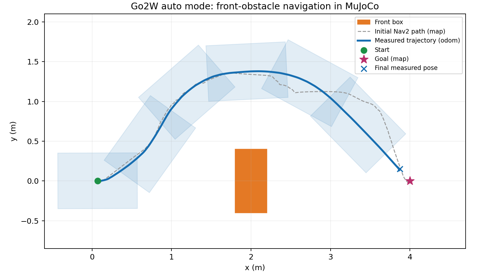

# Go2W auto 避障验证记录

2026-11-15，在本工作目录的 MuJoCo、已有 Go2W ONNX 和 ROS 2 Humble 上完成验证。
部署配置为 `control.mode: auto`，通过键盘完成站立、进入 Velocity 后下发导航目标。

场景为 `scene_go2w_mapping.xml`：前方箱子中心 `(2, 0)`、半长 0.2 m、
半宽 0.4 m、高 0.8 m。NavigateToPose 目标为 map 坐标 `(4, 0, yaw=0)`。
最终配置从初始位置出发，约 32.3 秒后返回 `SUCCEEDED`（status=4）；
该次执行没有进度失败、路径中止或恢复动作。

| 观测 | 结果 |
| --- | --- |
| 最终真值 odom XY | `(3.871, 0.151)` m |
| 最大横向绕行距离 | 1.380 m |
| 实际 `/cmd_vel` 最大绝对值 | vx=0.30 m/s，vy=0，wz=0.45 rad/s |
| 连续采样的真值位姿 | 2,768 个 |
| 1.0×0.7 m 导航 footprint 与箱子重叠的采样数 | 0 |
| footprint 与箱子的最小 SAT 分离间隙 | 0.522 m |
| 全局路径发布次数 | 32 |

分离间隙按每个 odom 样本的 XY/yaw，将保守矩形 footprint 旋转到世界坐标，
与场景箱子做分离轴检查得到；它是离散位姿上的几何检查，不是实机接触传感器读数。
目标判定使用 map 坐标，表中的最终位置来自 odom；在线 SLAM 的 map/odom 可有小幅偏差。

蓝线为真值轨迹，浅蓝矩形为沿途 footprint；虚线为最初的 map 路径。
[降采样轨迹 CSV](navigation_trial.csv) 与 [指标 JSON](navigation_metrics.json) 随记录保存。

验证还包括：

- `./autonomy/run.sh build` 构建所有五个包。
- 感知四个单元测试、导航速度管线的实际 ROS/DDS 集成测试通过。
- 导航集成测试覆盖：通行、近障停止、激光中断、速度中断、全无效扫描、
  缺失扫描 TF、重放旧扫描、非有限速度和有效数据恢复，使用独立 domain 197。
- `check` 确认点云/scan 约 10 Hz、odom 约 50 Hz、clock 约 100 Hz，地图及 TF 完整。
- 执行目标期间 `check-navigation --require-motion` 确认六个 Nav2 生命周期节点激活，
  有路径和运动输出，且 `/cmd_vel` 唯一发布者为 `velocity_guard`。
- CLI Ctrl-C 实际发出目标取消请求；RViz 导航配置可以加载。

本次验证范围是当前平地仿真和当前 ONNX。实机、复杂地形、视觉障碍、
已知地图 AMCL 定位不在已验证范围内。启动步骤见 [工作空间说明](../README.md)。
