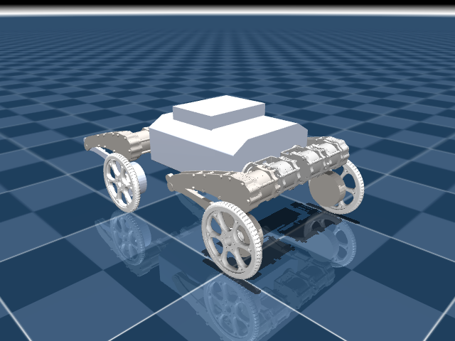

# Bodydemo03 机器人模型

从机械提供的 `Bodydemo03` 导出包整理而来，本目录保存 URDF 及其引用的网格。

## 文件

```text
bodydemo03/
├── bodydemo03_constants.py   # 模型加载、执行器、初始姿态、限位与碰撞配置
├── package.xml              # 保留原包名，供 package:// 路径解析使用
├── urdf/bodydemo03.urdf      # 原始 URDF 内容，文件名简化
├── meshes/*.STL             # URDF 引用的全部 17 个网格
├── xmls/bodydemo03.xml       # 转换的机器人模型，已增加机身自由关节
├── xmls/scene_bodydemo03.xml # 地面、灯光、展示伺服及 home 站姿
├── xmls/scene_bodydemo03_deploy.xml # Go2W 方式的力矩部署场景及 IMU
└── preview.png              # 场景 home 姿态预览
```

源包里的 ROS launch、CMake 文件、CSV、导出日志和空纹理目录不参与本模型的加载。
XML 使用 `../meshes/...` 相对路径，可连同本目录一起移动。

## 打开模型

在项目根目录运行：

```bash
conda activate unitree_rl_mjlab
python scripts/view_model.py src/assets/robots/bodydemo03/xmls/scene_bodydemo03.xml
```

默认加载 `home` 站姿并暂停，便于查看。按空格开始或暂停物理仿真，
按 `R` 或退格恢复到 `home` 并暂停。

场景中的机身初始高度为 0.34 m，腿轮关节均为 CAD 零位站姿。
机器人 XML 使用自由机身和被动关节，展示场景另外配置腿部位置伺服和轮速伺服；
默认控制为零，播放后会在重力、接触和伺服作用下运动。



## 使用 C++ simulate 查看

`simulate/config.yaml` 默认选择 Bodydemo03 的力矩部署场景：

```yaml
robot: "bodydemo03"
robot_scene: "src/assets/robots/bodydemo03/xmls/scene_bodydemo03_deploy.xml"
ros2_sensors_config: "ros2_sensors/config/bodydemo03.yaml"
```

`robot` 是机器人名称，实际加载路径由 `robot_scene` 决定。
在项目根目录编译并启动：

```bash
cmake --build simulate/build -j2
./simulate/build/unitree_mujoco
```

该场景配合 [Bodydemo03 部署控制器](../../../../deploy/robots/bodydemo03/README.md)
使用，Unitree SDK2 桥接保持启用，ROS 相机／雷达和弹簧吊带默认关闭。
空格开始/暂停，退格恢复 `home` 并暂停。
仅查看原来的内置伺服场景时，可显式指定：

```bash
./simulate/build/unitree_mujoco \
  --scene src/assets/robots/bodydemo03/xmls/scene_bodydemo03.xml
```

## Python 配置入口

与 Go2W 一样，可以从机器人的统一入口取得 `EntityCfg`：

```python
from src.assets.robots import get_bodydemo03_robot_cfg

robot_cfg = get_bodydemo03_robot_cfg()
```

环境中使用 `cfg.scene.entities = {"robot": robot_cfg}` 引用它。
`get_bodydemo03_spec()` 会同时加载 XML 和全部网格资源，供 mjlab 组装场景。
每次调用均返回独立配置和模型。

基础 `EntityCfg` 使用自由机身，初始高度 0.34 m、腿轮关节零位；
执行器由下面的 velocity 专用入口配置。

## Velocity 训练与回放模板

配置目录为 `src/tasks/velocity/config/bodydemo03/`，参照 Go2W 提供
`Bodydemo03-Flat` 和 `Bodydemo03-Rough` 两个任务。
`env_cfgs.py` 定义动作、观测、奖励和随机化；`rl_cfg.py` 定义 PPO；
`runner.py` 导出 checkpoint 和包含动作顺序、尺度及 PD 参数的 ONNX。

```bash
conda activate unitree_rl_mjlab
python scripts/list_envs.py --keyword Bodydemo03
python scripts/train.py Bodydemo03-Flat --env.scene.num-envs=512
python scripts/train.py Bodydemo03-Rough --env.scene.num-envs=256
```

Flat 日志位于 `logs/rsl_rl/bodydemo03_velocity/<时间>/`，Rough 位于
`logs/rsl_rl/bodydemo03_velocity_rough/<时间>/`。训练配置默认 1024 个并行环境、
5000 次迭代、每 1000 次保存一次；网格碰撞体较复杂，可按显存降低环境数。

```bash
# 使用零动作检查默认站姿，不需要 checkpoint。
python scripts/play.py Bodydemo03-Flat --agent=zero --num-envs=1

# 回放训练得到的策略；Rough 使用对应任务名及 checkpoint 目录。
python scripts/play.py Bodydemo03-Flat \
  --checkpoint-file=logs/rsl_rl/bodydemo03_velocity/<时间>/model_<迭代>.pt \
  --num-envs=1
```

模板约定：

- 自碰撞关闭，保留所有机器人碰撞体与地形的接触。
  非轮子部位触地且接触力超过 10 N 时终止回合。
- 初始机身高度 0.34 m，默认关节角均为 CAD 零位。
- 16 维动作：前 12 维按 `fl/fr/rl/rr` 的 hip/thigh/calf 顺序控制腿位置，
  hip 尺度为 0.125 rad，thigh/calf 为 0.25 rad；后 4 维依次控制
  `fl/fr/rl/rr_foot_joint` 的轮速，尺度为 5 rad/s。
  全部保留 URDF 关节方向，左右轮同向滚动需要相反符号的轮速。
- 策略频率 50 Hz：物理步长 0.005 s，decimation=4。
- Flat Actor 输入为 55 维；Rough 追加 187 维地形扫描，合计 242 维。
  累计轮转角不进入观测，全部关节速度进入观测。
- 速度范围、基础奖励、PPO 网络及随机化沿用 Go2W 起点。

### 基础奖励与继续训练

Flat 和 Rough 分别使用对应 Go2W 模板的 12 项基础奖励及权重，
静止命令比例为 10%。机器人专属的关节名称和模型参数按 Bodydemo03 配置。
Flat Actor 仍为 55 维输入、16 维输出，`rl_cfg.py` 的 PPO 超参数保持原设置。
详细接触评估可使用下面的独立诊断脚本。

修改奖励不会改变已有 checkpoint / ONNX 的行为，需要重新训练或继续训练后重新导出。
从原训练结果继续训练的例子：

```bash
python scripts/train.py Bodydemo03-Flat \
  --env.scene.num-envs=512 \
  --agent.resume=True \
  --agent.load-run=<原训练时间目录> \
  --agent.load-checkpoint=model_4999.pt \
  --agent.run-name=continued_training \
  --agent.max-iterations=2000
```

`max-iterations` 表示本次新增的训练迭代数，结果写入新的时间目录。
也可以使用本节前面的普通训练命令从头训练。替换部署 ONNX 前，应检查零命令时
四轮承重、实际轮速和漂移，并同时回放前进、后退和转向，确认运动能力没有退化。

机器人参数集中在 `bodydemo03_constants.py`：

| 参数 | 当前模拟模板值 |
| --- | --- |
| hip/thigh/calf 位置范围 | ±0.5 / ±1.0 / ±1.5 rad |
| 腿部 kp / kd / 力矩上限 | 400 / 12 / 50 Nm |
| 轮子 kp / kd / 力矩上限 | 0 / 2 / 8 Nm |
| 软关节限位比例 | 0.9 |

这些范围为 CAD 零位附近的临时模拟范围，电机参数参考当前展示场景，
均未按实际机构标定。调整默认姿态、限位和增益时从此处修改。
训练入口 `get_bodydemo03_velocity_robot_cfg()` 会添加命名碰撞体、轮轴 site、
IMU 和执行器；原始模型入口 `get_bodydemo03_robot_cfg()` 继续用于基础模型加载。
训练／回放使用 Python mjlab 环境。独立 C++ 仿真部署已按 Go2W 接入 Flat，
关节方向、动作映射、默认角度、观测尺度、限位和 PD 参数与训练对应。
策略周期 0.02 秒，独立部署场景物理步长 0.002 秒。
编译、键盘／手柄／ROS 控制、权重替换和专属差异见
[部署说明](../../../../deploy/robots/bodydemo03/README.md)。

### 训练环境接触诊断

怀疑轮子悬空或零命令空转时，可在原 mjlab 环境中对照零动作、固定轮速、
完整策略、仅策略腿部输出和固定重放策略腿姿态：

```bash
python scripts/diagnose_bodydemo03.py \
  --checkpoint logs/rsl_rl/bodydemo03_velocity/<时间>/model_<迭代>.pt

# 保留训练时的摩擦、重心和编码器偏置随机化，再做同样对照。
python scripts/diagnose_bodydemo03.py \
  --checkpoint logs/rsl_rl/bodydemo03_velocity/<时间>/model_<迭代>.pt \
  --randomization training
```

默认运行 8 个环境，每项先用零动作站立 2 秒，再测试 6 秒，
统计末尾 2 秒的四轮接触力、超过 5 N 的承重比例、机身速度、轮速和奖励。
`logs/diagnostics/bodydemo03/` 保存 JSON 报告及逐步 NPZ 数据；
`--num-envs`、`--seconds`、`--output` 可调整环境数、时长和输出目录。
该脚本只更改诊断进程内的配置，不改动训练参数、模型文件或部署权重。

## 模型信息

- 17 个机器人刚体、16 个腿轮关节、1 个机身自由关节、17 个 STL 网格。
- 四条腿，每条腿具有 hip、thigh、calf 三个旋转关节，以及一个连续轮轴关节。
- `fl`、`fr`、`rl`、`rr` 分别代表左前、右前、左后、右后。
- 原模型中的 `*_foot_link` / `*_foot_joint` 对应轮子和轮轴，保留原名。
- URDF 质量合计：23.47056 kg。

| 部位 | 关节名称模式 | 数量 |
| --- | --- | --- |
| 髋部 | `*_hip_joint` | 4 |
| 大腿 | `*_thigh_joint` | 4 |
| 小腿 | `*_calf_joint` | 4 |
| 轮轴 | `*_foot_joint` | 4 |

## 转换与核对

转换使用项目中的 `scripts/convert_urdf.py` 和 MuJoCo 3.5.0。
脚本已处理原导出包名 `##Bodydemo03.SLDASM` 中的 `#` 字符。

需要重新转换时，可指定一个新的输出文件名：

```bash
python scripts/convert_urdf.py \
  src/assets/robots/bodydemo03/urdf/bodydemo03.urdf \
  --output src/assets/robots/bodydemo03/xmls/bodydemo03_reexport.xml
```

已核对复制前后的 URDF 和全部网格内容一致、XML 能重新加载、整体目录移动后仍能加载。
在零位及另外 10 组关节角下，独立计算的 URDF 正向运动学与 MJCF 一致，
最大位置差约 `7.9e-7 m`。各刚体质量、重心和惯量也已核对。

## 后续训练需要补充的数据

原始 URDF 的 12 个腿部关节均导出了
`lower=0, upper=0, effort=0, velocity=0`；4 个连续轮轴关节没有这些限制值。
MuJoCo 3.5.0 将这些零范围腿部关节导入为不启用位置限位。
velocity 模板已添加临时腿部活动范围及电机参数，后续在
`bodydemo03_constants.py` 中替换。

机器人 XML 在原始导入结果上增加了机身自由关节，保留原来的网格碰撞体。
展示场景启用机器人与地面的碰撞，关闭机器人自身碰撞。
velocity 适配层保留网格碰撞体，并配置训练执行器和轮地接触检测。
